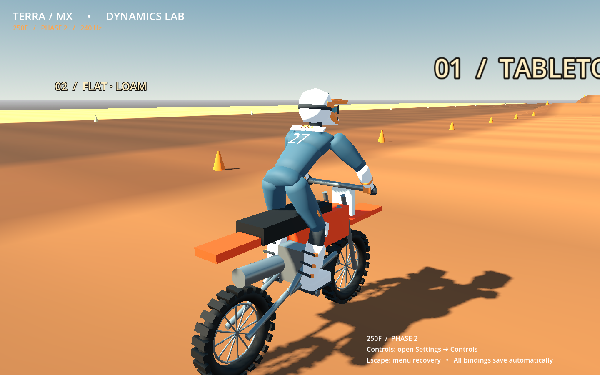

# Terra MX — Phase 2 / 0.2.0

Native Godot 4.6.3 motocross development build. The original chassis, powertrain, track, braking and flight foundation is retained. This update concentrates on tire response, virtual-rider steering, an original skinned motocross rider, and persistent in-game control customization.

**[Download Phase 2 for Windows x64](https://github.com/Ceeb68/Mx-game/raw/refs/heads/prototype-download/build/TerraMX-phase2-windows.zip)**

Extract the ZIP and run `TerraMX.exe`. No Godot installation is required for this export. OpenGL 3.3-capable graphics are needed. Windows execution and physical gamepad/vibration feel remain unverified on the Linux development machine. [The original build remains available](https://github.com/Ceeb68/Mx-game/raw/refs/heads/prototype-download/build/TerraMX-windows.zip) for comparison.



## What changed

- Tire force builds at smaller slip angles, with stable implicit wheel/contact coupling, speed-dependent contact-patch relaxation, and progressive sliding saturation. Existing dirt/sand friction coefficients are unchanged; force remains limited by the combined μFz budget.
- Three terrain rays sample each curved tire footprint. Rendered and physical ground still share one heightfield. No hidden lateral drag, chassis rotation assignment, extra roll stabilizer, or speed multiplication was added.
- A rate-limited virtual rider blends low-speed steering into lean control smoothly. It requests steering torque through the existing front assembly and limits requested lean to attainable steering/grip conditions. Optional grounded foot support remains explicit and switchable; flight is not auto-leveled.
- An original 17-bone skinned glTF rider replaces the old box/rod rider: helmet, goggles, jersey, pants, gloves and buckled boots. Analytic arm/leg IK constrains hands to the rotating handlebar and boots to visible footpegs; filtered stance, body input, acceleration and spring loading drive animation.
- Settings now has **Riding**, **Controls**, and **Response** tabs. Every gameplay action has keyboard and controller bindings, with axis/button/D-pad support, conflict handling, persistent settings, and disconnect/reconnect behavior.

The rider is an original stylized asset, not a licensed photorealistic character. Soil deformation, independent unsprung wheel bodies, full fork/linkage geometry, articulated rider physics, audio, advanced whips/scrubs and racing/career/multiplayer remain future work. Tire/control parameters are estimates requiring rider calibration. See [physics architecture](docs/ARCHITECTURE.md), [Phase 2 evidence](docs/VALIDATION.md), and [the Phase 2 request](docs/PHASE2_BRIEF.md).

## Default controls

| Action | Keyboard | Standard controller |
| --- | --- | --- |
| Throttle / front brake | W / S | RT / LT |
| Rear brake | Space | A / Cross |
| Steering | A / D | Left stick X |
| Body forward / backward | Up / Down | Right stick Y |
| Rider lateral lean | Q / E | Right stick X |
| Clutch disengage | Shift | LB / L1 |
| Shift up / down | Page Up / Page Down | RB / X |
| Stand / sit | Tab | Y / Triangle |
| Chase / rider camera | C | B / Circle |
| Reset | R | Back / View |
| Settings / pause | Escape | Start / Menu |
| Next lane / diagnostics | F6 / F1 | Assign in Controls if desired |

The chase and rider viewpoints are retained. The rider camera remains a basic development viewpoint, not a fully polished helmet camera.

## Customize and save controls

1. Open **Escape → Controls** (or Start/Menu, then the Controls tab).
2. Select the keyboard or controller cell for an action. Press a key/button or move the intended analog axis firmly from neutral. Steering and rider directions are bound separately to signed axis halves or digital buttons.
3. Drift below 0.25 and motion below 0.65 do not capture an axis. Return an already-deflected axis to neutral first. Escape or **Cancel rebind** cancels; an unanswered capture times out after 15 seconds.
4. Conflicts are shown before applying. **Swap** exchanges two bindings, **Replace** clears the previous assignment, and **Cancel** preserves the layout. **Reset all bindings** restores the standard layout.
5. Under **Response**, adjust steering/lean sensitivity and deadzones, throttle/brake deadzones, steering curve/smoothing, inversion, independent/combined rider lean, and vibration. **Riding** contains persistent assists and camera settings.

Changes save automatically to `user://controls_v2.cfg` (atomic file replacement). Existing first-build keyboard/controller mappings are migrated from `controls.cfg` when no v2 profile exists; the old file is preserved. On Windows, the normal location is `%APPDATA%/Godot/app_userdata/Terra MX · Dynamics Lab/`. With `launch.sh`, data is under `.godot/runtime/data/godot/app_userdata/Terra MX · Dynamics Lab/` unless XDG variables are already supplied.

Controller mappings are device-independent and apply to the first connected gamepad. Disconnecting clears transient input and cancels capture; reconnecting retains mappings. Resume/reconnect waits for riding controls to return to neutral before accepting throttle or steering. **Escape remains an emergency menu shortcut after remapping Pause**, and is reserved for cancelling a capture. Menus use Godot's normal mouse/keyboard/D-pad focus navigation. A physical gamepad and vibration still need hands-on verification.

## Short hands-on test

1. Ride the straight with assists at defaults. Make small left/right corrections, then a progressive sweeper and a left/right reversal at 25–40 km/h. Compare with the retained original build.
2. Try a standing start and a slow turn. Brake straight, then apply light front brake midcorner. Deliberately lock the rear brake in a safe area and release it to recover.
3. Approach the small tabletop around 40–50 km/h. Brief rear brake in flight should still pitch the nose down; land and continue. Use R if needed.
4. Toggle sitting/standing, body position and camera. Look for seat clipping, floating boots, hand separation or abrupt joint transitions; the rider is presentation-only and must not add physical stabilization.
5. Rebind throttle to a trigger and a keyboard key, swap two conflicts, change response settings, quit/relaunch and confirm they persist. Unplug/reconnect the controller, release its controls, and confirm the saved layout still works.

Report lane, speed, gear, assist/response settings, controller model, and the exact input sequence for problems. Bounded automated improvements do not establish that the riding feel is fixed.

## Develop and test

Install **Godot 4.6.3 standard** (no .NET). Import `project.godot`, then F5, or:

```sh
cd /workspace/Mx-game
./launch.sh --editor
./launch.sh
./tests/run_all.sh
```

`launch.sh` supplies writable XDG directories when absent. The full suite runs the shipped scene/controller, input/UI tests, a separate-process profile reload, skeletal IK checks, and expanded handling scenarios. Graphical capture: `godot --path . --script res://tests/capture_phase2.gd` with a display. Headless tests cannot establish subjective riding or physical controller behavior.

The rider asset is retained at `assets/rider/terra_rider.glb`. Its reproducible original Blender source is `tools/build_rider.py`; rebuild with `blender -b --python tools/build_rider.py`, then reimport in Godot. Blender is needed only to edit/regenerate the character, not to run or export the game. No external character assets or textures are used.

## Export

Use matching 4.6.3 standard templates. The prepared cloud machine retains checksum-verified templates under `/workspace/.mx-runtime/data/godot/export_templates/4.6.3.stable`.

```sh
mkdir -p build/windows build/linux
XDG_DATA_HOME=/workspace/.mx-runtime/data godot --headless --path . --export-release 'Windows Desktop'
XDG_DATA_HOME=/workspace/.mx-runtime/data godot --headless --path . --export-release Linux
```

Presets explicitly include bike JSON and the referenced glTF rider; tests/docs/authoring tools are excluded from the runtime pack. `build/TerraMX-phase2-windows.zip`, `build/TerraMX-phase2-linux.zip`, and `build/TerraMX-phase2-source.zip` contain this update. Engine notices are in `docs/licenses/` and included in packages. No publication or Windows execution is implied by a successful local export.
