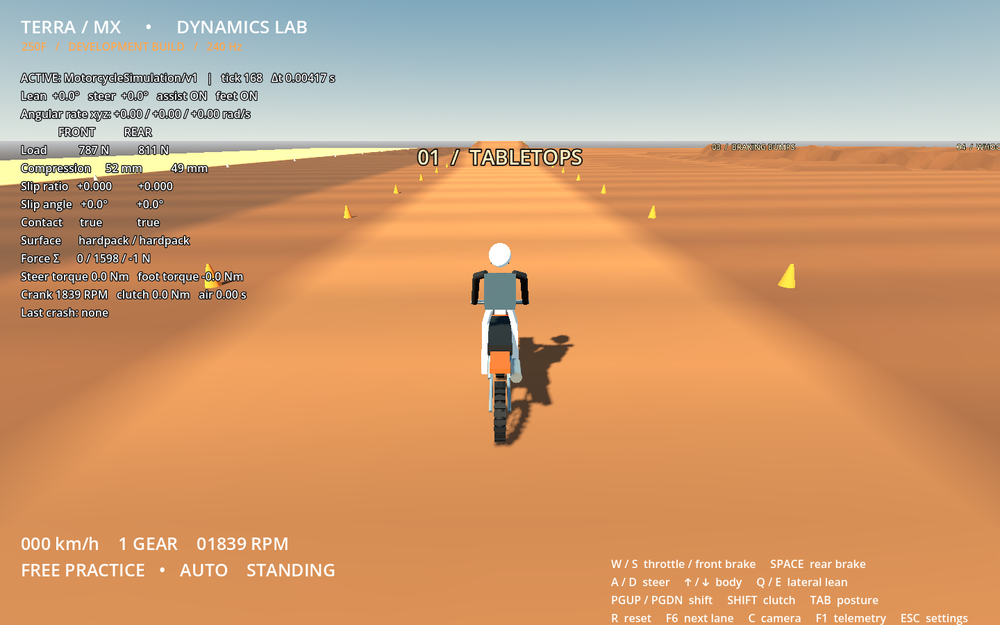

# Terra MX — motorcycle dynamics prototype

A native Godot 4.6.3 PC development build: one original 250F engineering proxy, a physical dirt test environment, and a single force-based motorcycle simulation at 240 Hz. This begins Phase A and selected Phase B systems from [the project brief](docs/PROJECT_BRIEF.md). It is an early riding prototype, not a validated commercial motorcycle simulator.



## Launch

**Windows x64:** extract `build/TerraMX-windows.zip`, then double-click `TerraMX.exe`. No Godot installation is needed for the exported build. OpenGL 3.3-capable graphics are required. Windows execution has not been tested on this Linux machine.

**From source:** install Godot **4.6.3 standard** (GDScript, no .NET). Import `project.godot` in Godot and press **F6 on `scenes/main.tscn` or F5**. Or run:

```sh
godot --path /path/to/Mx-game
```

On this cloud machine:

```sh
cd /workspace/Mx-game
./launch.sh                       # requires a graphical display
./launch.sh --editor              # editor
./tests/run_all.sh                # headless live-runtime tests
```

`launch.sh` gives Godot writable XDG directories under `.godot/runtime/` when those variables are absent. No package installation, assets, accounts, or service credentials are needed. The Linux export is `build/linux/TerraMX.x86_64`.

## Default controls

| Action | Keyboard | Standard gamepad |
| --- | --- | --- |
| Throttle / front brake | W / S | RT / LT |
| Rear brake | Space | A |
| Steering | A / D | Left stick X |
| Body forward / backward | Up / Down | Right stick Y |
| Body lateral position | Q / E | Right stick X |
| Clutch disengage | Shift | LB |
| Shift up / down | Page Up / Page Down | RB / X |
| Stand / sit | Tab | Y |
| Chase / rider camera | C | B |
| Reset | R | Back / View |
| Settings / pause | Escape | Start / Menu |
| Next test lane | F6 | Keyboard only |
| Diagnostics | F1 | Keyboard only |

Escape opens a menu that freezes the bike, exposes assists, FOV, follow distance, sensitivity, and deadzone, and provides Resume and Exit buttons. Menus use Godot's mouse, keyboard, and standard gamepad focus navigation. Keyboard labels in the HUD show defaults.

Both keyboard and gamepad mappings are loaded from `user://controls.cfg`: `[keys]` uses Godot physical key integers; `[gamepad]` uses Godot axis/button indices. First launch writes defaults. With `launch.sh`, the file is under `.godot/runtime/data/godot/app_userdata/Terra MX · Dynamics Lab/`; with Windows defaults it is under `%APPDATA%/Godot/app_userdata/Terra MX · Dynamics Lab/`. Quit before editing and restart afterward. Input settings in that file persist; menu slider/assist changes are session-only. Physical gamepad hardware has not been available for testing.

## First ride

1. Stay on the spawn straight. Apply throttle gently; brake using S, then try the rear brake separately. Watch front/rear load and suspension values in F1 diagnostics.
2. Reach 20–30 km/h, then make brief, modest A/D inputs. Keyboard full lock is a full lean request with steering assistance enabled. Try both directions in the open flat area; use R after a fall.
3. Press F6 once for the flat loam lane. Practice smooth corners before the jumps. Further presses cycle bumps, whoops, sand, berm, then the tabletop lane.
4. For the small tabletop, approach at roughly 40–50 km/h, reduce throttle near takeoff, and shift weight forward. In air, a brief rear-brake tap pitches the nose downward; throttle with an engaged clutch can pitch it upward. Avoid holding either throughout the jump.
5. In Escape settings, disable Automatic shifts to test Page Up/Down. Keep clutch assist on initially. Disable foot support or steering assistance separately to examine their effect; these are development controls and raw handling is not validated.
6. Report speed, gear, lane, assist settings, and what happened. Include whether the symptom was entry, midcorner, takeoff, flight, or landing. We need actual riding feedback before calling the handling correct.

## What exists

- One authoritative `RigidBody3D` chassis; per-wheel ground rays, spring/damper loads, combined tire-force limit, wheel inertia, explicit wheel momentum reactions and approximate gyroscopic coupling.
- Data-driven engine torque curve, crank inertia, slipping clutch, five gears, independent brakes, engine drag, optional auto shifting/clutch assistance.
- Steering assembly inertia and torque servo. Optional lean-to-steering controller initiates countersteering; it never assigns chassis orientation. Optional bounded grounded foot-support torque below 3 m/s is displayed in telemetry.
- Combined rider/bike COM shift, original procedural bike/rider proxies, suspension-linked wheel/fork/swingarm visuals, chase and rider viewpoints.
- Collision heightfield with a straight, open flat corner area, berm, two tabletops, bumps, whoops, rough loam, and sand. Surface grip and rolling resistance affect forces.
- Live diagnostics, manual reset, persistent-impact crash state, pause/exit menu, headless simulation and input tests, Windows/Linux export presets.

## Limits and next milestone

The tire coefficients, inertias, torque curve, suspension and control gains are engineering estimates. They are **not calibrated against a measured real motorcycle**. The contact patch is a ray, wheels have no independent unsprung translation, suspension uses chassis-up rays rather than full fork/linkage kinematics, and soil is static. Balance assists and gearbox behavior need rider validation. Crash detection is a provisional sustained-contact/lean heuristic; no rider separation or ragdoll exists.

The bike and rider are visibly simple procedural proxies, with approximate joint positioning rather than a complete IK solver. Audio, sophisticated airborne rider momentum/whips/scrubs, terrain deformation, saved setups, racing, AI, replay, career, multiplayer, polished content, and licensing-ready manufacturer assets are not implemented. No 60 FPS performance claim is made from software-rendered cloud testing.

Next: ride and review the acceptance checklist in [VALIDATION.md](docs/VALIDATION.md), then refine tire calibration, low-speed transitions, suspension geometry and rider control. Keep content expansion behind the handling gate. Architecture and force ownership are described in [ARCHITECTURE.md](docs/ARCHITECTURE.md).

## Export

Install Godot's matching **4.6.3 export templates** through the editor. Both presets include the JSON bike definition explicitly.

```sh
mkdir -p build/windows build/linux
godot --headless --path . --export-release 'Windows Desktop'
godot --headless --path . --export-release Linux
```

On the cloud machine, templates have been installed in `/workspace/.mx-runtime/data/godot/export_templates/4.6.3.stable`. Set `XDG_DATA_HOME=/workspace/.mx-runtime/data` when rebuilding there. The official full template archive was verified against the release SHA-512 manifest before use. Exported runtime notices are in `docs/licenses/` and included in the downloadable packages.
